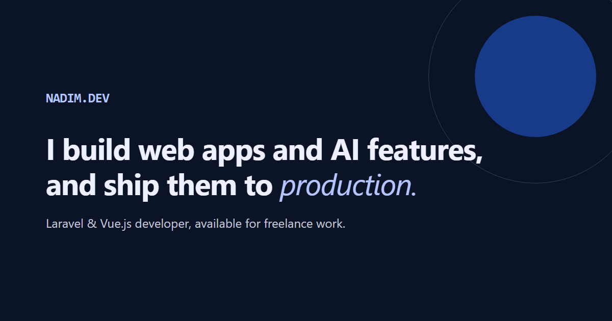

# Nadim El Chammaii — Portfolio

My personal portfolio site: a single-page site that presents my work as a full-stack (Laravel & Vue.js) developer, the projects I've shipped, and how to hire me for freelance work.

**🔗 Live demo: [nadimdev.vercel.app](https://nadimdev.vercel.app/)**



## What it does

The site walks a visitor (usually a client or recruiter) from "who is this?" to "how do I contact them?":

- **Hero**: headline, availability badge, and an animated 3D visual built with Three.js
- **Projects**: featured projects (AskMyDocs, PulseBoard, TrackMyWallet), each with screenshots, tech stack, source links, and a **live demo** you can try
- **Services**: the kinds of freelance work I take on
- **How I work**: my process, step by step
- **Experience & education**: work history and degree
- **Skills**: grouped tech stack
- **About & contact**: short bio, email, GitHub, LinkedIn, Upwork, and a downloadable CV

It also has:

- Dark theme by default, with a light/dark toggle that remembers your choice
- Responsive layout for phone, tablet, and desktop
- Open Graph and Twitter card metadata, so links shared on social media show a preview image

## Tech stack

| Area | Tools |
| --- | --- |
| Framework | [Vue 3](https://vuejs.org/) + [Vite](https://vite.dev/) |
| UI library | [Vuetify 4](https://vuetifyjs.com/) (components, theming, utility classes) |
| Language | TypeScript |
| Routing | Vue Router |
| 3D / animation | [Three.js](https://threejs.org/) |
| Styling | SCSS (Vuetify settings + scoped component styles) |
| Fonts | Inter, Space Grotesk, JetBrains Mono (via Fontsource) |
| Icons | Material Design Icons |
| Code quality | ESLint (`eslint-config-vuetify`), `vue-tsc` type checking |
| Hosting | Vercel |

No Pinia, Vue I18n, or Tailwind: the site has no shared state beyond the theme, is single-language, and Vuetify's utilities cover the styling.

## Run it locally

**Requirements:** Node.js 22+ and npm.

```bash
git clone https://github.com/nadimelchammaii-hash/portfolio.git
cd portfolio
npm install
npm run dev
```

Then open **http://localhost:3000** in your browser.

To check the production build:

```bash
npm run build     # type-checks, then builds into dist/
npm run preview   # serves the built dist/ folder locally
```

## Scripts

| Command | What it does |
| --- | --- |
| `npm run dev` | Start the dev server with hot reload (port 3000) |
| `npm run build` | Type-check and build for production |
| `npm run build-only` | Build without type-checking |
| `npm run preview` | Preview the production build |
| `npm run type-check` | Run `vue-tsc` type checking |
| `npm run lint` | Lint the code |
| `npm run lint:fix` | Lint and auto-fix what can be fixed |

## Project structure

```
src/
├── pages/index.vue        # the single page: lists the sections in order
├── components/
│   ├── layout/            # header (nav + theme toggle) and footer
│   ├── sections/          # one component per page section (Hero, Projects, ...)
│   └── ui/                # reusable cards, chips, headings, 3D hero visual
├── data/                  # all site content: profile, projects, skills, experience, ...
├── types/content.ts       # TypeScript types for the content in data/
├── composables/           # useAppTheme (light/dark toggle + persistence)
├── plugins/               # Vuetify and router setup
└── styles/                # global SCSS and Vuetify settings
public/                    # CV, favicons, OG image, project screenshots
```

### Editing content

All text and links live in [`src/data/`](src/data/), separate from the components. To add a project, update the bio, or change contact links, edit the matching file there (for example [`projects.ts`](src/data/projects.ts) or [`profile.ts`](src/data/profile.ts)). Project screenshots go in [`public/projects/`](public/projects/).

## Deployment

The site is deployed on Vercel at [nadimdev.vercel.app](https://nadimdev.vercel.app/). It's a static build: Vercel runs `npm run build` and serves the `dist/` folder.

## Contact

- GitHub: [@nadimelchammaii-hash](https://github.com/nadimelchammaii-hash)
- LinkedIn: [nadimelchammaii](https://www.linkedin.com/in/nadimelchammaii/)
- Or use the contact section on the [live site](https://nadimdev.vercel.app/#contact)
